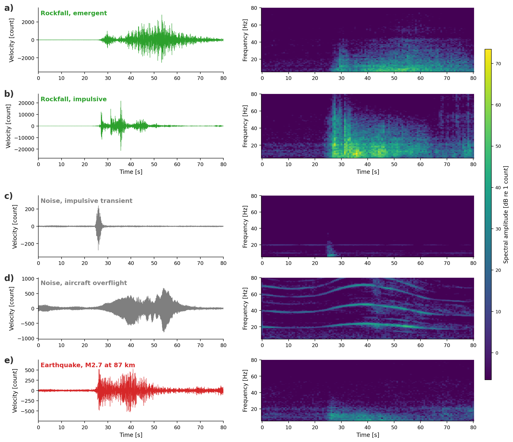
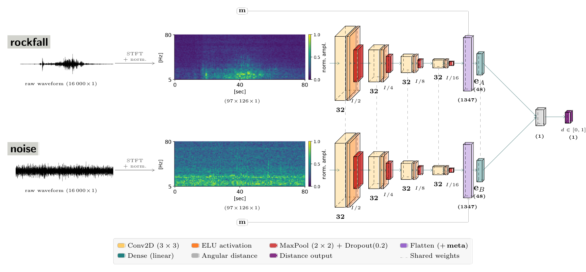

# Blatten rockfall detection

Few-shot deep learning for detecting small rockfalls in continuous seismic data from the Kleines Nesthorn after the 2025 Blatten collapse (Lötschental, Switzerland).

**Status: work in progress.** Code will be released upon publication. Paper in preparation at the Swiss Seismological Service (ETH Zürich).

## Problem

Large slope failures such as the May 2025 Blatten collapse are often preceded by increasing rockfall activity. Building a rockfall catalogue from continuous seismic data is hard for three reasons: labelled events are scarce, rockfall signals vary widely in shape, and they have to be separated from earthquakes, aircraft and other noise.

*Rockfalls (green) next to the noise sources and earthquakes (grey & red) that a detector has to reject.*

## Approach

- Siamese Neural Network (SNN) on spectrograms: an embedding is learned in which rockfalls lie close together and far away from noise. The network is trained contrastively from a small set of labelled events.
- Inference pipeline: each window of continuous data is scored by its angular distance to a set of labelled rockfall templates. New examples can be added without retraining.
- Benchmarks: compared against embeddings from a pretrained seismic foundation model and the performance of a classical STA/LTA detector, on labelled continuous data.

---
MSc thesis, ETH Zürich, supervised by Dario Jozinović and John Clinton
